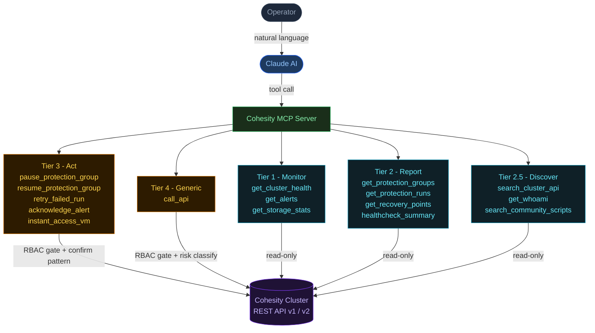

# AI Meets Data Protection: What I Built and What It Unlocks

*All opinions expressed here are my own and do not represent those of any current or previous employer.*

---

There is a category of problem in enterprise IT that I think of as the **runbook treadmill**: tasks that are important enough to have a documented procedure, repetitive enough that operators resent doing them, and subtle enough that a distracted operator can still make a costly mistake. Health checks, alert triage, failed-backup remediation, DR test prep - data protection operations are full of them.

I built a Model Context Protocol (MCP) server that connects Claude directly to a Cohesity cluster. The goal was to see whether an AI assistant could handle the runbook treadmill while keeping a human in the decision loop for anything consequential. This post walks through the design, the safety architecture, the real capabilities it unlocks today, and where I think this goes.

> The complete source is at [github.com/vishuadapa/cohesity-automation](https://github.com/vishuadapa/cohesity-automation). This is a personal SE demo tool - not an official Cohesity product.

---

## What is MCP?

[Model Context Protocol](https://modelcontextprotocol.io/) is an open standard (published by Anthropic in 2024) for connecting AI assistants to external tools and data sources. Think of it as a standardized plugin interface: you define Python functions decorated with `@mcp.tool()`, and the AI assistant discovers and calls them just like calling any other function - except the function is expressed in natural language by the user.

The minimal setup looks like this:

```python
from mcp.server.fastmcp import FastMCP

mcp = FastMCP("cohesity")

@mcp.tool()
def get_cluster_health() -> dict:
    """Cluster identity, version, node count, and overall health/status."""
    # ... call Cohesity REST API
    return { "name": ..., "healthy": ..., "nodeCount": ... }
```

When you wire this to Claude Desktop, asking *"Is my cluster healthy?"* causes Claude to call `get_cluster_health()`, read the structured response, and answer in plain English - including flagging stopped services, sync issues, or healing states without the operator needing to know which API endpoint or field to look at.

The server supports two transports:
- **stdio** (default) - for Claude Desktop on your laptop
- **Streamable HTTP** - for VS Code Copilot, web integrations, or any MCP-compatible client

```bash
# Claude Desktop (stdio)
python cohesity_mcp_v2.py

# VS Code / HTTP client
MCP_TRANSPORT=http python cohesity_mcp_v2.py
```

---

## Architecture: Four Tiers of Increasing Consequence

The MCP server is organized around a deliberate escalation model. Every tool sits in one of four tiers, and the tiers reflect increasing operational impact.



**Tier 1 (Monitor)** - Pure reads. These are safe to call any time, and they form the foundation of every interactive session. `get_cluster_health` hits two endpoints simultaneously and synthesizes a single healthy/unhealthy signal with stopped services surfaced. `get_alerts` filters by severity. `get_storage_stats` returns capacity, usage, and data-reduction ratios.

**Tier 2 (Report)** - Still read-only, but at the protection-group layer. `get_protection_groups` returns the last-run status of every group. `get_protection_runs` gives run history for a specific group with optional failure-only filtering. `get_recovery_points` lets you ask *"what snapshots do I have for vm-prod-01?"* and get back timestamped, named results. `healthcheck_summary` combines health + critical alerts + failed groups into one call.

**Tier 2.5 (Discover)** - This is where it gets interesting. Three tools that help the AI understand what it can do before doing it: `get_whoami` (current user identity, Cohesity roles, effective risk ceiling), `search_cluster_api` (live Swagger search), and `search_community_scripts` (AI-powered community script lookup - more on this below).

**Tier 3 (Act)** - Mutating operations, all using the confirm pattern (more on this shortly). Pause/resume protection groups, trigger on-demand runs, acknowledge alerts, and Instant Access VM recovery.

**Tier 4 (Generic)** - The escape hatch: `call_api` lets Claude call any Cohesity endpoint by HTTP method and path, gated by RBAC classification.

---

## The Safety Architecture

This is the part I'm most proud of, because it's the part that makes the tool actually trustworthy in an operator's hands.

### Risk Taxonomy

Every operation gets classified into one of five risk levels:

```python
_RISK_READ        = 0   # GET - safe, no side effects
_RISK_REVERSIBLE  = 1   # POST/PUT that can be undone (pause, resume, trigger run)
_RISK_CAUTION     = 2   # POST/PUT with lasting side-effects (create, modify config)
_RISK_DESTRUCTIVE = 3   # DELETE, or operations that permanently alter data
_RISK_BLOCKED     = 4   # Refused regardless of role, forever
```

The hardcoded block list catches the catastrophic actions that no SE demo should ever be able to do:

```python
_ALWAYS_BLOCKED_SUBSTRINGS = [
    "factory-reset", "destroy-cluster", "destroycluster",
    "wipe-data", "erase-data", "unregister-cluster",
]
```

If the API path contains any of these strings, the tool refuses - full stop, no RBAC check, no confirm prompt. The AI cannot talk its way past this.

Classification is path-based for the generic executor:

```python
def _classify_risk(method: str, path: str) -> int:
    if m == "GET": return _RISK_READ
    if m == "DELETE": base = _RISK_DESTRUCTIVE
    else: base = _RISK_REVERSIBLE
    
    if any(s in path.lower() for s in ["delete", "destroy", "purge"]):
        base = max(base, _RISK_DESTRUCTIVE)
    elif any(s in path.lower() for s in ["create", "config", "setting", "modify"]):
        base = max(base, _RISK_CAUTION)
    return base
```

### RBAC-Aware Gating

The server fetches the current user's Cohesity roles from `/public/sessionUser` and maps them to a maximum risk ceiling:

```python
_ROLE_CEILING: dict[str, int] = {
    "kViewer":          _RISK_READ,       # read-only, nothing else
    "kOperator":        _RISK_REVERSIBLE, # can pause/resume/trigger
    "kDataSecurity":    _RISK_CAUTION,    # can create/modify
    "kAdmin":           _RISK_DESTRUCTIVE,# full access
    "kSuperAdmin":      _RISK_DESTRUCTIVE,
}
```

If a `kOperator` user asks Claude to delete a protection policy, the RBAC gate fires before any API call leaves the server:

```
REFUSED: RBAC check failed.
Your roles (kOperator) permit up to 'REVERSIBLE' operations.
This request is classified as 'DESTRUCTIVE'.
Elevate your Cohesity role or ask an admin to perform this action.
```

### The Confirm Pattern

Every mutating Tier 3 tool requires two calls to execute. The first call (confirm=False) returns a structured proposal; the second call (confirm=True) executes. This is not a UI affordance - it is enforced in code:

```python
@mcp.tool()
def pause_protection_group(group_id: str, confirm: bool = False) -> dict:
    group = _get(f"{BASE_V2}/data-protect/protection-groups/{group_id}")
    if not confirm:
        return {
            "proposed_action": "PAUSE protection group",
            "group": group.get("name"),
            "currently_paused": group.get("isPaused"),
            "impact": "Future scheduled runs will not start. Existing snapshots unaffected.",
            "to_execute": "Call again with confirm=true",
        }
    body = {"action": "kPause", "ids": [group_id]}
    result = _post(f"{BASE_V2}/data-protect/protection-groups/states", body)
    return {"executed": "pause", "group": group.get("name"), "result": result}
```

In practice, this surfaces to the operator as a natural conversation checkpoint. Claude proposes the action in plain language, the operator reads it, and explicitly says *"yes, proceed"* before anything happens.

---

## Real Scenarios: Natural Language Operations

Here are a few interactions that showcase what this enables today.

### Scenario 1: Morning Health Check

> **Operator**: "What's the state of my cluster?"

Claude calls `healthcheck_summary()` - which internally calls `get_cluster_health`, `get_alerts(severity="kCritical")`, and `get_protection_groups` in sequence - and responds:

> *"Your cluster is running Cohesity 7.1.2 with 6 nodes. There are 3 open critical alerts - two disk-health warnings on node 4 and one replication lag alert. Across your 23 protection groups, the SQL Production and VMware NAS groups both failed their last run. Want me to pull the failure details for those two groups?"*

Three API calls, synthesized into one actionable answer. The operator didn't need to know which endpoints to check or how to interpret `bulletinState.stoppedServices`.

### Scenario 2: Investigating a Failed Backup

> **Operator**: "Why did the SQL Production group fail?"

Claude calls `get_protection_runs(group_id, only_failed=True)` and reads the `messages` field:

> *"The last run failed 4 hours ago. Error: 'Agent communication timeout on sqlprod-03.' 5 of 6 objects succeeded; only sqlprod-03 failed. Do you want me to trigger a retry now?"*

> **Operator**: "Yes, run it again."

Claude calls `retry_failed_run(group_id, confirm=False)` first, presents the proposal:

> *"I'll trigger an on-demand run for 'SQL Production'. This will start a new backup run immediately and consume cluster resources. Confirm?"*

> **Operator**: "Confirm."

Claude calls `retry_failed_run(group_id, confirm=True)`. Done.

### Scenario 3: Checking Recovery Points Before a DR Drill

> **Operator**: "What's my most recent clean snapshot for vm-prod-crm?"

Claude calls `get_recovery_points("vm-prod-crm")`, returns a timestamped list of snapshots with their protection group, run type, and expiry. The operator picks a point in time, and can then use `instant_access_vm` to mount it without a full restore.

---

## Dynamic API Discovery: The Escape Hatch

Not every operation has a dedicated tool. That's where `search_cluster_api` and `call_api` come in - they make the MCP server extensible without requiring code changes.

### Finding Endpoints at Runtime

`search_cluster_api` fetches the cluster's live Swagger spec and searches it by keyword:

> **Operator**: "Can you find the endpoint for listing storage domains?"

Claude calls `search_cluster_api("storage domain")` and gets back:

```json
[
  {
    "method": "GET",
    "path": "/v2/storage-domains",
    "summary": "Get Storage Domains",
    "risk": "READ (safe)",
    "parameters": [{ "name": "names", "in": "query", "required": false }]
  }
]
```

It then calls `call_api("GET", "/v2/storage-domains", confirm=False)` to propose the call, and `confirm=True` to execute - all within the same conversation.

This is important: the AI is using the cluster's own API documentation, live, to discover capabilities. It's not working from a hardcoded list.

### Community Script Discovery with AI

The most experimental feature: `search_community_scripts` uses GitHub's code search API to scan [Brian Seltzer's Cohesity community scripts](https://github.com/bseltz-cohesity/scripts) for a use case, fetches the matching Python scripts, and uses Claude to extract the underlying REST API pattern:

```python
@mcp.tool()
def search_community_scripts(query: str, max_results: int = 3) -> list[dict]:
    """Search Brian Seltzer's Cohesity community scripts repo for a use case
    not natively supported by this MCP."""
```

> **Operator**: "I need to expire old snapshots manually. Is there a script for that?"

Claude searches the community repo, finds `expireSnapshots.py`, and extracts the API call pattern. It then proposes executing it via `call_api` - all without the operator needing to read a Python script or know which endpoint handles snapshot expiry.

When `ANTHROPIC_API_KEY` is set, Claude itself does the extraction using its code-reading capabilities, producing a structured `body_template` with the required inputs identified. Without an API key, a regex fallback extracts the raw `api()` call signatures from the pyhesity helper pattern.

---

## Instant Access: AI-Driven Recovery Testing

The `instant_access_vm` tool implements the Cohesity Instant Access pattern - booting a VM directly from a backup snapshot without restoring it to primary storage first. It handles the full workflow: search for the protected object, find the latest local snapshot, build the v2 recovery API body, handle vCenter targeting, and enforce the confirm pattern.

```python
@mcp.tool()
def instant_access_vm(
    vm_name:          str,
    prefix:           str  = "",
    suffix:           str  = "",
    power_on:         bool = True,
    detach_network:   bool = True,  # recommended for DR/test - avoids IP conflicts
    target_source_id: int  = 0,     # 0 = recover to original vCenter
    confirm:          bool = False,
) -> dict:
```

> **Operator**: "Spin up vm-prod-crm from its latest backup as a test clone. Prefix it with 'vishu-' and keep it network-isolated."

Claude calls `instant_access_vm("vm-prod-crm", prefix="vishu-", detach_network=True, confirm=False)`, presents the proposal including the snapshot timestamp and protection group, and waits for confirmation. After `confirm=True`, the VM boots from Cohesity storage within minutes - no waiting for a full restore.

The `detach_network=True` default matters: recovering to the same vCenter with the same IP as the source VM would cause a network conflict. The tool defaults to network isolation for exactly this reason, and explains it in the proposal.

---

## The Art of the Possible

The tools I've described are useful today. But I think they're a stepping stone to something more interesting: **AI agents that manage data protection workflows proactively**, not just reactively.

### Proactive Health Monitoring with Agentic Loops

An MCP-connected agent running on a schedule can:
1. Call `healthcheck_summary` every morning
2. Identify failed groups automatically
3. For each failure, call `get_protection_runs(only_failed=True)` to read error messages
4. Triage: transient timeout vs. persistent configuration error vs. agent issue
5. For transient failures: propose `retry_failed_run` and wait for operator approval via a notification
6. For persistent failures: escalate with a structured incident summary

This is qualitatively different from a static alert rule. The agent reads context - the error message, the failure history, the object count - and produces a *diagnosis*, not just a notification.

### Natural Language DR Drills

Today, running a DR drill requires an operator to: find the right VM, locate a clean snapshot, mount it, verify it boots, check application responsiveness, then tear it down. With this MCP server, the entire workflow becomes:

> "Start a DR drill for the CRM tier. Use the last clean snapshot. Isolate networking. Report back when the VMs are up."

The agent handles snapshot selection, Instant Access for each VM in the tier, network isolation, and status polling - with human approval at the launch step. The operator reviews a readout, not a runbook.

### Ransomware Response Automation

During a ransomware incident, one of the first actions is isolating affected systems and identifying the last known-clean recovery point. This is time-critical and error-prone when done manually.

An AI agent with access to this MCP server can:
1. Identify which protection groups cover the affected systems
2. Pull recovery points and flag the ones taken *before* the anomaly timestamp
3. Pause protection groups covering affected systems (to prevent encrypting the backups)
4. Mount candidate clean snapshots for forensic analysis
5. Produce a structured recovery plan with specific snapshot IDs and timestamps

This cuts the time-to-clean-mount from hours to minutes, and eliminates the possibility of accidentally restoring *to* the ransomware payload rather than *before* it.

### Policy Compliance as a Conversation

Today: run a report, read a spreadsheet, write findings in a deck.

With MCP: *"Show me every protection group where the local retention is less than 14 days, there's no replication target, and DataLock is not enabled."*

The agent calls `get_protection_groups`, then `call_api` on the policies endpoint, joins the data, and answers in natural language with a table. If you want to fix a gap: *"Clone the Gold-30-Day policy to SQL-DR and attach it to the SQL Production group."* The agent proposes, you confirm, it's done.

---

## Getting Started

If you want to connect this to Claude Desktop:

**1. Install dependencies**

```bash
pip install "mcp[cli]" httpx
```

**2. Set environment variables**

```bash
export COHESITY_CLUSTER=mycluster.lab.local
export COHESITY_API_KEY=your-api-key-here
# Optional: COHESITY_VERIFY_SSL=true for production clusters with valid certs
```

**3. Add to Claude Desktop config** (`~/Library/Application Support/Claude/claude_desktop_config.json` on Mac):

```json
{
  "mcpServers": {
    "cohesity": {
      "command": "python",
      "args": ["/path/to/cohesity-automation/cohesity_mcp_v2.py"],
      "env": {
        "COHESITY_CLUSTER": "mycluster.lab.local",
        "COHESITY_API_KEY": "your-api-key-here"
      }
    }
  }
}
```

Restart Claude Desktop, and you'll see the Cohesity tools appear in the tool list. Start with: *"What's the health of my cluster?"*

For VS Code / Copilot:

```bash
MCP_TRANSPORT=http MCP_HTTP_PORT=8720 python cohesity_mcp_v2.py
```

Then add `http://localhost:8720` as an MCP endpoint in your client.

---

## What I Learned

A few things that surprised me building this:

**The confirm pattern is underrated.** I initially thought two-call execution would feel clunky. In practice, it feels *right* - the proposal step forces the AI to articulate what it's about to do, which surfaces misunderstandings before they become incidents.

**RBAC gating belongs in the tool, not just in the prompt.** You can instruct an LLM to "only perform actions the user is authorized for," but that's a soft constraint. Fetching roles at runtime and refusing at the code level is a hard constraint. The difference matters.

**Dynamic discovery changes the capability ceiling.** A static list of tools limits what the AI can do to what you anticipated when you wrote the code. Adding `search_cluster_api` and `search_community_scripts` turns the AI into something that can reason about the full API surface - and find its own way to accomplish tasks you didn't explicitly build for.

**Instant Access is underutilized.** Most customers use it for full disaster recovery testing. But as a lightweight DR *drill* mechanism - mount a VM for 30 minutes, verify application health, tear it down - it's remarkably powerful and fast. Pairing it with an AI agent that can select the right snapshot and manage the lifecycle makes it accessible without deep Cohesity expertise.

The MCP server is about 650 lines of Python. The real work was in the design decisions: where to draw the tier boundaries, how aggressive to make the block list, what the confirm pattern should say. Those choices determine whether operators trust the tool enough to use it in production.

I'm continuing to develop this, and the community script discovery feature in particular has a lot of room to grow. If you're working on something similar or have feedback, I'd love to hear from you.
