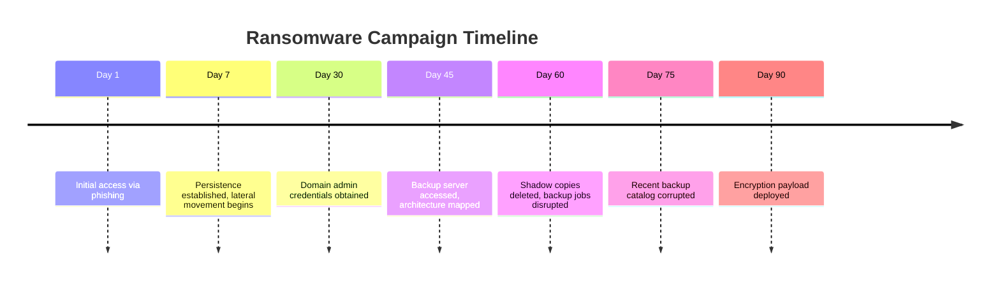

# Why Ransomware Recovery Requires More Than Just Backups

In 2019, a "good" ransomware defense was a recent backup. You restored from tape, rebuilt your servers, and were back online in a few days. The adversary got nothing; you lost a weekend.

That era is over.

Modern ransomware operations are run by sophisticated criminal enterprises with professional project management, specialized teams, and multi-month dwell times. They have adapted specifically to defeat backup-centric recovery strategies. Understanding how they do it is the first step toward designing a recovery strategy that actually works against them.

## How Modern Ransomware Defeats Traditional Backups

Before detonating their payload, professional ransomware operators follow a predictable playbook that directly targets your ability to recover:

**Phase 1 — Initial access and persistence** (Days 1–14). Initial access typically comes via phishing, credential stuffing, or exploitation of an internet-facing service. The first goal is persistence: multiple footholds across different systems so that removing one doesn't kill the campaign.

**Phase 2 — Reconnaissance and privilege escalation** (Days 14–60). Attackers map the environment looking for: domain admin credentials, backup server locations, tape library connectivity, cloud storage accounts, and offline backup media rotation schedules. They want to understand your recovery strategy so they can undermine it before the attack.

**Phase 3 — Backup destruction** (Days 60–90). This is the step that changed everything. Attackers with domain admin credentials:
- Delete Volume Shadow Copies on every server via `vssadmin delete shadows /all /quiet`
- Access the backup server and delete recent recovery points from within the console
- If cloud backups exist and credentials are stored in the environment, delete them too
- Corrupt the backup catalog so remaining recovery points appear valid but fail during restore

**Phase 4 — Detonation** (when satisfied with coverage). The encryption payload fires. By this point, the most recent months of backups may be gone, corrupted, or encrypted. The ransom demand arrives with proof that your recovery options are limited.

The implication is stark: by the time you see the ransomware note, your attacker has been in your environment for three months and has already systematically dismantled your recovery capability.

## What a Modern Recovery Strategy Requires

Defeating this threat model requires layering controls that cannot all be compromised through the same attack surface. Here is what that looks like in practice.

### Immutable Backups (WORM Storage)

Recovery points must be written to storage with a Write-Once-Read-Many (WORM) policy. Once written, they cannot be deleted, modified, or encrypted — not by the backup software, not by a domain admin, not by the backup software vendor's own administrative interface — until the retention window expires.

This is the foundational control. Without immutability, everything else is defense in depth around a core that can still be wiped.

### Air-Gap or Controlled Data Path

The backup infrastructure must be architecturally isolated from the production environment. This doesn't mean a VLAN; it means a true network boundary with a controlled, unidirectional data path that can be closed when not actively syncing.

An attacker with domain admin credentials should not be able to reach your backup infrastructure via the same network paths they used to reach your servers.

### Separate Administrative Identity

Vault administrative credentials must be completely separate from production identity systems. If your vault can be administered using domain admin credentials, it can be compromised by anyone who compromises domain admin.

This means: separate credentials, separate MFA, ideally a separate identity management system that is not joined to production Active Directory.

### ML-Based Anomaly Detection on Backup Data

Signature-based detection on production systems catches known ransomware, but sophisticated operators use custom tooling that evades signatures. Behavioral detection on backup data takes a different approach: instead of looking for malware, it looks for the effects of malware.

Entropy analysis on backup content can detect the statistical signature of encryption across large file sets before you'd otherwise notice. A sudden increase in entropy across your file share backups, or a spike in the number of files changing their extension, is a strong signal of an active encryption campaign — potentially days before detonation.

The advantage: even a novel, never-before-seen ransomware variant produces the same entropy signature when it encrypts files. Behavioral detection is not fooled by new tooling.

### The 3-2-1-1-0 Rule

The classic 3-2-1 backup rule (3 copies, 2 different media types, 1 offsite) was designed for accidental data loss. The modern extension is 3-2-1-**1-0**:

- **3** copies of data
- **2** different media types
- **1** offsite copy
- **1** copy offline, air-gapped, or immutable (the "cyber copy")
- **0** backup errors — validated by automated recovery testing

The zero errors requirement is what most organizations skip. A backup that has never been recovery-tested is not a backup; it is an untested assumption.

### Multi-Factor Recovery Authorization

The ability to delete recovery points, disable retention policies, or export data from the vault must require multi-factor approval by at least two authorized personnel. A single compromised administrator account should not be sufficient to destroy your recovery capability.

Some platforms implement a "time-lock" on dangerous administrative operations: a deletion or policy change is queued but not executed for a configurable hold period (e.g., 24–72 hours), allowing security monitoring to detect and cancel a malicious operation before it takes effect.

## The Recovery Sequence

When ransomware does detonate, the recovery sequence matters as much as the backup architecture. A clean room recovery approach:

1. **Isolate and assess**: Determine scope. Which systems are encrypted? What is the last known-clean recovery point? This step can take 12–48 hours.
2. **Establish clean room**: Spin up an isolated network environment with no connectivity to production. This is where you'll validate recovered workloads before reconnecting them.
3. **Recover from immutable vault**: Restore the most recent clean recovery point for each critical workload into the clean room environment. The vault's anomaly detection logs give you a timestamp for when suspicious activity began, helping identify which recovery points pre-date the compromise.
4. **Validate before reconnecting**: Test application health in the clean room. Confirm no malware artifacts remain. Only reconnect to production after this validation is complete.
5. **Staged reconnection**: Bring systems back online in dependency order. Monitor closely for signs of re-infection.

The clean room step is where most organizations stumble. Recovering directly to production without validation risks re-introducing a dormant ransomware infection that survived in a recovered workload.

## Conclusion

The ransomware threat has professionalized. Backup-centric defense without immutability, isolation, and anomaly detection is no longer an adequate strategy against a motivated adversary who plans to be in your environment for 90 days before you know they're there.

The goal is to make recovery achievable even when everything else in your environment has been compromised. That requires controlling your recovery infrastructure like a separate security domain — because that is exactly what it needs to be.

---

*All opinions expressed here are personal and do not represent the views of any employer, past or present. No confidential or proprietary information is shared.*
