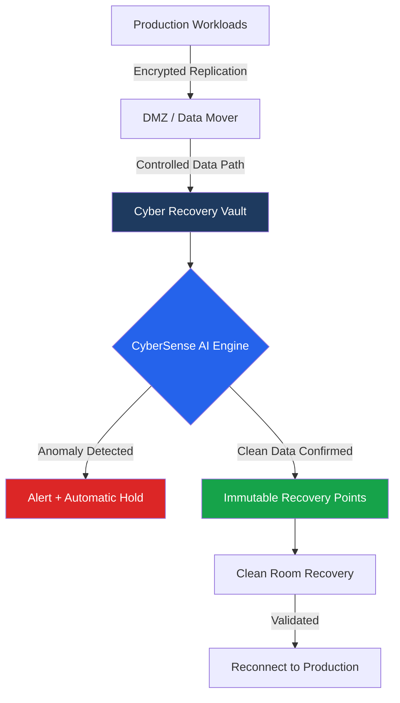

# Zero Trust Meets Data Protection: Building a Modern Cyber Recovery Vault

The cyber threat landscape has fundamentally shifted. Ransomware operators no longer just encrypt files — they first spend weeks or months dwelling inside your environment, mapping your backup infrastructure, deleting shadow copies, and corrupting recovery points before detonating their payload. By the time the ransom note appears, your traditional backup strategy may already be compromised.

Zero Trust isn't a product. It's a security philosophy — and one that applies just as powerfully to your data protection architecture as it does to your network perimeter.

## The Core Problem with Traditional Backup Architecture

Most enterprise backup strategies were designed for accidental data loss: hardware failure, user error, a corrupted database. They were not designed to withstand a motivated adversary with months of access and administrative credentials.

The weaknesses are predictable:

- **Backup servers sit on the same network** as production systems, reachable by any attacker who compromises a domain admin account
- **Backup agents run with elevated privileges** on every protected host — a perfect lateral movement vector
- **Recovery validation is infrequent** (quarterly at best), so corrupted recovery points often go undetected until the moment they're needed
- **Administrative access to backup infrastructure** is often overly broad, with no MFA enforcement and no separation from standard IT admin roles

In short: your backups are as exposed as everything else on your network.

## Zero Trust Principles Applied to Data Recovery

Zero Trust distills to three imperatives: never trust, always verify, assume breach. Here is what that means in the context of a cyber recovery vault:

### 1. Never Trust — Isolate the Vault

A cyber recovery vault must be architecturally isolated from the production environment. This means more than a VLAN boundary. True isolation requires:

- **Air-gap or controlled data path**: Data replication into the vault occurs over a dedicated, monitored connection that can be closed. When not actively syncing, the vault is unreachable from production networks.
- **Separate identity plane**: The vault runs its own identity management stack. Production Active Directory credentials do not work inside the vault. Administrative access requires vault-specific credentials with MFA.
- **No inbound connections from production**: The vault pulls data rather than accepting pushed connections from production backup servers.

### 2. Always Verify — Enforce Multi-Factor for Every Recovery Action

Administrative actions inside the vault — configuration changes, deletion of recovery points, manual data export — require multi-factor authentication by a second approver. This is not about complexity. It is about ensuring that a single compromised account cannot silently wipe your last line of defense.

Equally important: verify the integrity of your backups continuously. Anomaly detection on backup jobs (unusual change rates, entropy spikes, unexpected deletion patterns) can surface an active ransomware campaign days before it detonates.

### 3. Assume Breach — Design for Recovery, Not Just Protection

Zero Trust's third tenet is the one most relevant to DR: assume that production has already been compromised and design your recovery capability accordingly. This means:

- **Immutable retention**: Recovery points are WORM-locked for a policy-defined period. Even a vault administrator cannot delete them within the retention window.
- **Clean room recovery environment**: Maintain a pre-provisioned, isolated clean room where recovered workloads can be spun up and validated before being reconnected to production.
- **Recovery runbooks that assume no trust**: Documented procedures that do not rely on production DNS, production AD, production network infrastructure, or production identity services.

## A Reference Architecture

The data mover sits in a DMZ and acts as the only bridge between production and the vault. When not actively syncing, the controlled data path is closed. Inside the vault, an ML engine scans backup content for entropy anomalies, file type changes, and known ransomware signatures — not on the production systems, but on the backup data itself, safe from tampering.

## Key Controls Checklist

When evaluating or building a cyber recovery vault, use this as a starting baseline:

| Control | Why It Matters |
|---------|----------------|
| Air-gap or controlled data path | Prevents lateral movement into the vault |
| Separate vault identity / no production AD | Compromised domain admin cannot touch the vault |
| MFA for all administrative vault actions | Single-account compromise cannot delete recovery points |
| WORM / immutable retention | Even rogue insiders cannot destroy recovery points within policy window |
| ML-based anomaly detection on backup data | Surfaces ransomware activity days before detonation |
| Pre-validated clean room environment | Reduces RTO by eliminating setup time during a crisis |
| Isolated DNS, NTP, networking inside vault | Recovery does not depend on potentially compromised production infrastructure |
| Regular recovery validation (automated) | Confirms recoverability; detects corruption before you need it |

## What to Look for in a Platform

A few capabilities that separate a true cyber recovery vault from a repurposed backup server in a different rack:

- **Content scanning on backup data** — entropy-based detection, not just signature matching
- **Automated recovery validation** — boots a VM from the backup, confirms application health, reports SLA compliance
- **Operator-less recovery modes** — in a crisis, you may not have your normal admin team available; procedures and tooling should support recovery with reduced staffing
- **Unified management across hybrid cloud** — your vault should protect workloads across AWS, Azure, GCP, and on-premises without requiring separate tooling for each

## Conclusion

Zero Trust is not a checkbox. Applied to data protection, it means treating your backup infrastructure with the same rigor you apply to your perimeter: isolate it, verify every action against it, and design it from the ground up to survive a full production compromise.

Your backup is not your last line of defense unless it is isolated from everything that could be compromised along with production.

---

*All opinions expressed here are personal and do not represent the views of any employer, past or present. No confidential or proprietary information is shared.*
